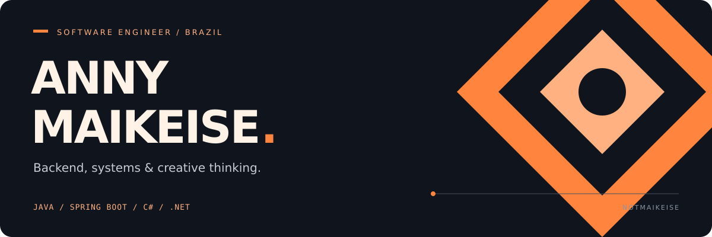

  

  <a href="#about">About</a> &nbsp; / &nbsp;
  <a href="#expertise">Expertise</a> &nbsp; / &nbsp;
  <a href="#stack">Stack</a> &nbsp; / &nbsp;
  <a href="#learning">Learning</a> &nbsp; / &nbsp;
  <a href="#beyond-code">Beyond code</a>

 

### 01 / The engineer behind the code

I'm **Anny**, a software engineer based in **Brazil**, focused on backend development with **Java and Spring Boot**. My experience spans APIs, microservices and integrations, with work across **FinTech, payments and enterprise systems**.

I also work across the stack with **C# / .NET, SQL, HTML, CSS and JavaScript**. I enjoy understanding business rules, tracing how systems communicate and turning that knowledge into maintainable software.

  
  
  

 

### 02 / Where I contribute

<table>
  <tr>
    <td width="50%" valign="top">
      <h3>↗ Backend &amp; integrations</h3>
      
REST APIs, microservices and communication between systems, with attention to business rules and maintainability.

      
<code>Java</code> <code>Spring Boot</code> <code>C#</code> <code>.NET</code>

    </td>
    <td width="50%" valign="top">
      <h3>⌘ Business systems</h3>
      
Experience with payments, FinTech and ERP contexts, connecting technical decisions to the processes they support.

      
<code>Payments</code> <code>FinTech</code> <code>ERP</code> <code>SQL</code>

    </td>
  </tr>
</table>

 

### 03 / My working toolkit

**Backend & build**

**Frontend & data**

**Development tools**

Also used: Mercurial and TortoiseHg.

  
<b>Explore my architecture &amp; engineering interests</b>

   
  <ul>
    <li><b>Architecture:</b> Domain-Driven Design, Clean Architecture, Hexagonal Architecture and system design.</li>
    <li><b>Foundations:</b> object-oriented programming, SOLID, design patterns and clean code.</li>
    <li><b>Backend:</b> REST APIs, microservices and integrations.</li>
    <li><b>Business domains:</b> FinTech, payments, ERP and enterprise systems.</li>
  </ul>

 

### 04 / What I'm exploring

Deepening my knowledge of **Java, Spring Boot and software architecture**, with a focus on domain modeling, microservices and distributed systems.

> Understand the domain. Make the tradeoffs explicit. Keep improving the design.

 

### 05 / A creative side, too

Outside software engineering, I enjoy **Minecraft, games, digital art and worldbuilding**. Automation and creative coding are where these interests meet my technical work.

   
  <b>Software · Systems · Games · Stories</b> 
  ANNY MAIKEISE / NOTMAIKEISE

