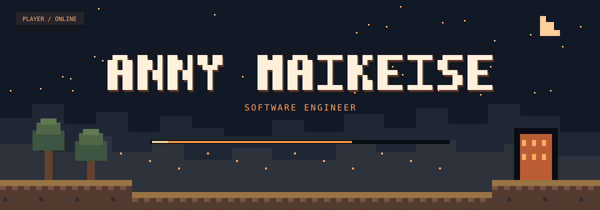
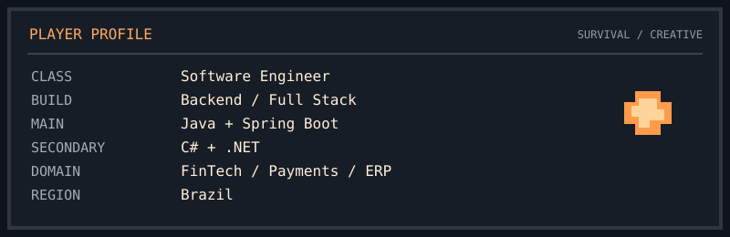
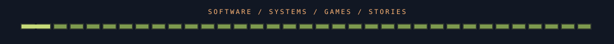

<div align="center">




<br />



</div>

<br />

## ⛏️ `./about_me`

Backend-oriented Software Engineer working with **Java, Spring Boot, APIs, microservices and integrations**. Also building with **C# / .NET, SQL and Full Stack development**.

`FinTech` · `Payments` · `ERP` · `Business Systems`

<br />

## 🧰 `TECH INVENTORY`

#### ⚔️ Main equipment — Backend


`REST APIs` · `Microservices` · `Integrations`

#### 💎 Resources — Frontend & Data


#### 🔨 Crafting table — Tools


`Mercurial` · `TortoiseHg`

<br />

## 📖 `ENCHANTMENT BOOK`

```yaml
architecture: [DDD, Clean, Hexagonal, System Design]
principles:   [OOP, SOLID, Design Patterns, Clean Code]
backend:      [REST, Microservices, Integrations]
domains:      [FinTech, Payments, ERP]
```

## 🧭 `ACTIVE QUESTS`

`Java` · `Spring Boot` · `Software Architecture` · `DDD` · `Distributed Systems`

## 🌱 `SIDE QUESTS`

`Minecraft` · `Games` · `Digital Art` · `Automation` · `Worldbuilding` · `Creative Coding`

<br />

<div align="center">




</div>
